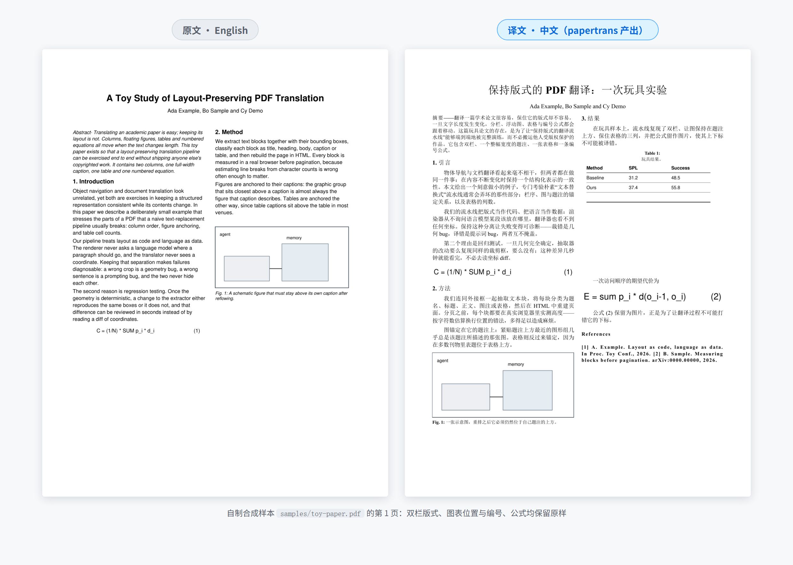
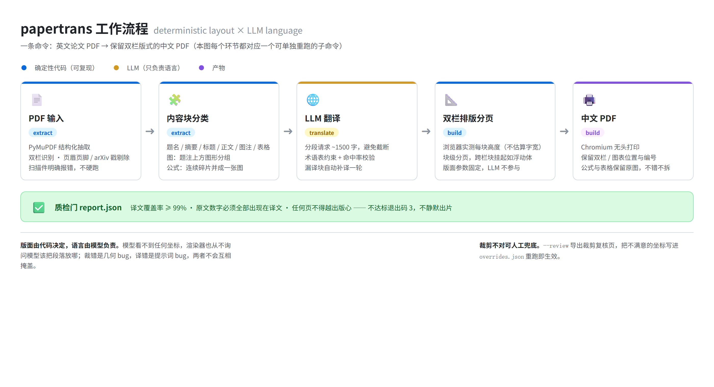

# papertrans

[](https://github.com/XiaoMa-77/paper-zh-translator/actions/workflows/ci.yml)

把英文论文 PDF 翻成中文 PDF，**保留原文的双栏版式、图表位置与编号**。

本地命令行工具：没有服务端、没有数据库，除调用模型翻译那一步外不联网。



---

## 它解决什么问题

直接把译文塞回原文位置，版式一定会崩：双栏变成单栏、图跑到下一节、表格错位、公式被拆成碎句。
多数"PDF 翻译"工具止步于可读，不再管排版。

这个工具把两件事彻底分开：**版面由代码决定，语言由模型负责**。模型看不到任何坐标，渲染器也从不询问模型该把段落放哪。代价是需要针对 PDF 做一遍结构化抽取，收益是出错时能立刻定位——裁错是几何 bug，译错是提示词 bug，两者不会互相掩盖。

## 快速开始

```bash
pipx install .            # 或 pip install -e .
papertrans doctor         # 检查 PyMuPDF / Chromium / 中文字体

papertrans run paper.pdf -o build/paper
# → build/paper/paper.zh.pdf  +  report.json
```

只想先看抽取对不对，不浪费模型调用：

```bash
papertrans run paper.pdf -o build/paper --provider none
```

## 配置翻译模型

`--provider openai` 走 OpenAI 兼容接口（OpenAI / DeepSeek / 通义 / 本地 vLLM、Ollama 的 OpenAI 端点都可以），用环境变量配置：

```bash
export LLM_BASE_URL=https://api.deepseek.com/v1   # 不设则默认 https://api.openai.com/v1
export LLM_API_KEY=sk-xxxx
export LLM_MODEL=deepseek-chat                    # 也可用 --model 覆盖

papertrans run paper.pdf -o build/paper --provider openai
```

没有 API Key 时用 `--provider none`：不翻译、原样回填，用来验证抽取与版式。

## MCP 接入（让 AI 助手调用）

安装 MCP 支持后，Claude Desktop 等客户端可以直接把论文翻译当工具调用：

```bash
pip install "papertrans[mcp]"     # 或 pip install -e '.[mcp]'
```

客户端配置（以 Claude Desktop 为例，`claude_desktop_config.json`）：

```json
{
  "mcpServers": {
    "papertrans": {
      "command": "papertrans-mcp",
      "env": { "LLM_API_KEY": "sk-xxx", "LLM_BASE_URL": "https://api.deepseek.com/v1", "LLM_MODEL": "deepseek-chat" }
    }
  }
}
```

提供的工具：`doctor`（环境自检）、`extract_structure`（只抽取检查）、`translate_workdir`（翻译，需 LLM）、`build_pdf`（排版出片）、`qa_report`（质检）、`translate_paper`（一条龙）。兼容 mcp 1.x/2.x。

## 命令

| 命令 | 作用 |
|---|---|
| `papertrans run <pdf> -o <dir>` | 一条龙：抽取 → 翻译 → 排版 → 打印 → 质检 |
| `papertrans extract <pdf> -o <dir> [--review]` | 只抽取，产出 `doc.json` + `fig/`，可先检查 |
| `papertrans translate <dir> --provider openai` | 单独翻译（改术语不必重抽） |
| `papertrans build <dir>` | 单独排版打印（改译文不必重译） |
| `papertrans report <dir>` | 打印质检报告 |
| `papertrans doctor` | 环境自检 |

常用参数：

```bash
--provider none|openai      # none = 不翻译，只验版面（默认）
--model gpt-4o-mini         # 也可用 LLM_MODEL 环境变量
--glossary glossary.yaml    # 术语表，模板见 examples/glossary.example.yaml
--style academic            # 翻译风格，注入提示词（academic/plain 等）
--columns 1|2               # 强制栏数，默认自动判断
--tables auto|image         # 表格：auto=尝试重建可编辑 HTML（失败回退图片），image=一律保留为图
--review                    # 导出裁剪复核页
```

退出码：`0` 通过、`3` 需人工复核、`4` 渲染失败。可直接用于脚本判断。

## 工作原理



四个经过踩坑才定下来的决定：

1. **分页用实测高度**，不靠估算字宽。让浏览器真排一遍，取 `offsetHeight`，再按 96dpi→pt 换算。
2. **跨栏块放不下就挂起**，下一页顶端安置（类似 LaTeX 浮动体）。CSS 的 `column-span: all` 会在分页处留半页空白。
3. **公式保持为图**。转成 MathML 好看，但错一个下标比排版丑严重得多。数学符号本身也不需要翻译。
4. **字体只用可分发的** Noto Serif CJK（OFL）。SimSun 仅授权 Windows 客户端，不能进镜像。

## 质检

每次 `build` 写 `report.json`，并据此决定退出码：

`run`、`translate`、`build` 和对应 MCP 工具默认执行原文完整性检查，不需要额外开关：

- **直接对照输入 PDF**：逐页核对原文块是否由文本、完整图片或表格覆盖；单独核对图、表、算法数量和参考文献编号。标题被误裁进图片、图像裁剪重叠、边缘切到内容都会标为需复核。
- **语义漏译复核**：使用翻译接口逐段对照英文和中文，核查论点、条件、否定、数值与实体。候选问题必须引用实际原译文，再经二次确认；无证据的判断或漏审段落不能通过。
- **最终 PDF 核对**：检查完整译文块是否实际打印，图片是否缺失、改变、重复或越界；按原 PDF 像素验证保护为图的公式、算法和图表。重建表格丢失数字/勾选符号时自动退回原图。

语义复核会额外使用模型接口。结果按原始 PDF 和译文内容的指纹缓存；修改原文或译文后自动失效并重新复核。缺少接口、调用失败或检查未完成时，中文结果不会标为通过。`--provider none` 只验证抽取与版面，报告明确显示语义检查 `not_applicable`。

报告分别记录 `source_audit`、`translation_review` 和 `printed_audit`，问题包含原文页码、块 ID 与证据。规则检查和模型复核可以发现遗漏与版面损坏，复杂学术含义仍需结合具体问题人工判断。

| 检查 | 阈值 |
|---|---|
| 译文覆盖率 | ≥ 99%（按块） |
| 数字一致性 | 原文数字必须全部出现在译文 |
| 版心溢出 | 任何页文字不得越出下边界 |
| 图 / 表 / 公式 | 数量与原文一致 |

不达标 → 退出码 3，**不静默出片**。

## 裁剪不对怎么办

自动定位对"图在上、题注在下"的常规版面有效，但矢量图、跨页表、密集公式仍可能裁歪。两步兜底：

```bash
papertrans extract paper.pdf -o build/x --review
# 打开 build/x/review/index.html 逐张看
# 把不满意的坐标写进 build/x/overrides.json：{"b0123": [45,120,567,330]}
papertrans extract paper.pdf -o build/x     # 重跑生效
```

## 能力边界

| 环节 | 现状 |
|---|---|
| 文本、分栏、标题层级 | 稳定；页眉页脚、arXiv 戳、版权行自动剔除 |
| 图（位图 / 带框矢量图） | 稳定，多数无需干预 |
| 表 | 优先重建为可编辑 HTML 表格（pdfplumber，置信度不足自动回退为图）；表题翻译，单元格保留原文 |
| 公式 | 常见单/多行公式整体成图，`cases` 分段式不会被切半行；行内公式多为 Type3 字体，抽不出字符，段落会断开——本版按垂直重叠把碎片拼回段落，但公式本身缺失 |
| 参考文献 | 保留英文原样 |
| 扫描件 | 明确报错，不硬跑（OCR 未实现） |

## 仓库文件清单

| 文件 | 用途 | 运行必需 |
|---|---|---|
| `src/papertrans/*.py` | 程序本体（抽取、翻译、构建、分页、渲染、质检、CLI） | 是 |
| `pyproject.toml` | 打包与依赖声明 | 是 |
| `tests/smoke.py` | 冒烟测试，结构级 + 端到端 | 否（开发用） |
| `tools/make_sample.py` | 生成合成样本，供演示与回归 | 否 |
| `samples/toy-paper.pdf` | 自制合成样本（2 页双栏），不含任何他人论文 | 否 |
| `docs/pipeline.png` | README 工作流程图 | 否 |
| `docs/compare.png` | README 原译对比图，由样本真实产出 | 否 |
| `docs/preview.png` | 早期单页预览图 | 否 |
| `examples/glossary.example.yaml` | 术语表模板 | 否 |
| `.github/workflows/ci.yml` | CI：ruff + 结构测试 + 样本端到端 | 否 |
| `Dockerfile` | Linux 容器运行环境（Chromium + Noto CJK） | 否（可选） |
| `DESIGN.md` | 设计取舍与可行性分析的存档 | 否 |
| `CHANGELOG.md` | 更新日志 | 否 |
| `README.md` `LICENSE` `.gitignore` | 文档与仓库配置 | 否 |

**不提交的内容**（见 `.gitignore`）：`build/`、`__pycache__/`、`.venv/`、`*.zh.pdf`、`overrides.json`、`samples/demo/`、日志、`.idea/`、`.vscode/`、系统临时文件。仓库里只有源码、打包配置和一份自制样本，克隆下来即可运行。

## 开发

```bash
python tests/smoke.py                                          # 结构级
PAPERTRANS_SAMPLE=/path/to/paper.pdf python tests/smoke.py      # 含端到端
python tools/make_sample.py                                    # 重新生成样本
```

改动 `extract.py` 或 `build.py` 后，至少跑一遍 `run --provider none` 并翻页检查——版式问题只看 `report.json` 看不出来。

## 许可

MIT。详见 `LICENSE`。

**关于译文**：整篇翻译属于演绎作品。本仓库只提供工具，不附带任何他人论文的译文；用它生成的 PDF 请自行在授权范围内使用。
