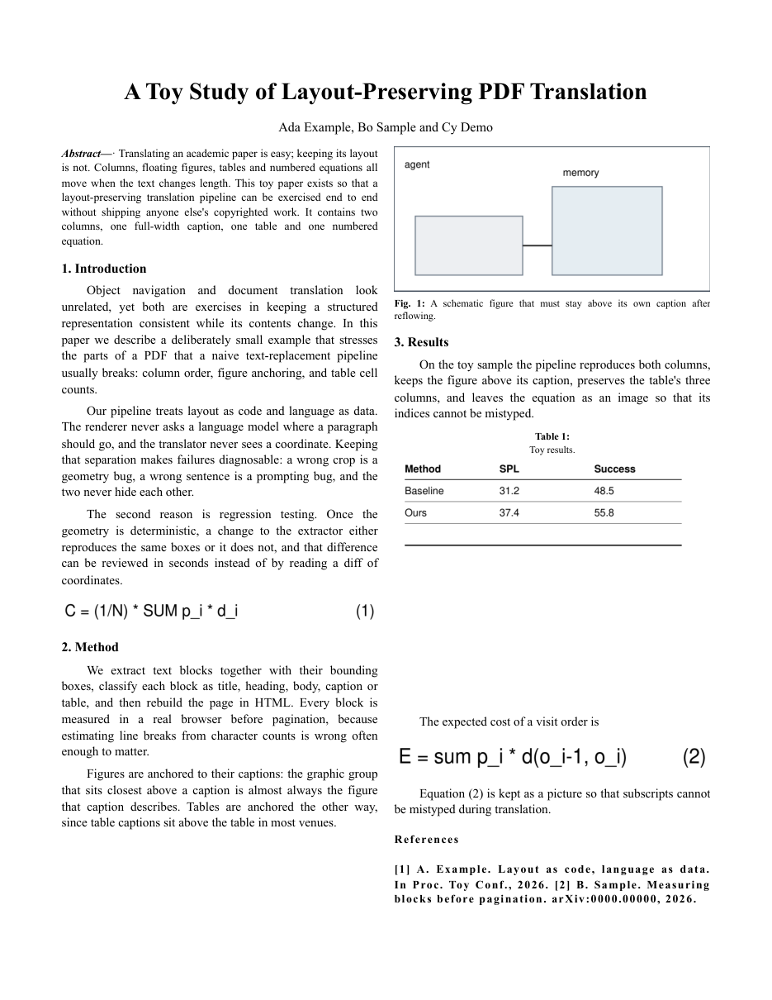

# papertrans

把英文论文 PDF 翻成中文 PDF，**保留原文的双栏版式、图表位置与编号**。

本地命令行工具：没有服务端、没有数据库，除调用模型翻译那一步外不联网。



---

## 它解决什么问题

直接把译文塞回原文位置，版式一定会崩：双栏变成单栏、图跑到下一节、表格错位、公式被拆成碎句。
多数"PDF 翻译"工具止步于可读，不再管排版。

这个工具把两件事彻底分开：**版面由代码决定，语言由模型负责**。模型看不到任何坐标，渲染器也从不询问模型该把段落放哪。代价是需要针对 PDF 做一遍结构化抽取，收益是出错时能立刻定位——裁错是几何 bug，译错是提示词 bug，两者不会互相掩盖。

## 快速开始

```bash
pipx install .            # 或 pip install -e .
papertrans doctor         # 检查 PyMuPDF / Chromium / 中文字体

papertrans run paper.pdf -o build/paper
# → build/paper/paper.zh.pdf  +  report.json
```

只想先看抽取对不对，不浪费模型调用：

```bash
papertrans run paper.pdf -o build/paper --provider none
```

## 命令

| 命令 | 作用 |
|---|---|
| `papertrans run <pdf> -o <dir>` | 一条龙：抽取 → 翻译 → 排版 → 打印 → 质检 |
| `papertrans extract <pdf> -o <dir> [--review]` | 只抽取，产出 `doc.json` + `fig/`，可先检查 |
| `papertrans translate <dir> --provider openai` | 单独翻译（改术语不必重抽） |
| `papertrans build <dir>` | 单独排版打印（改译文不必重译） |
| `papertrans report <dir>` | 打印质检报告 |
| `papertrans doctor` | 环境自检 |

常用参数：

```bash
--provider none|openai      # none = 不翻译，只验版面（默认）
--model gpt-4o-mini         # 也可用 LLM_MODEL 环境变量
--glossary glossary.yaml    # 术语表，形如 ObjectNav: 物体目标导航
--columns 1|2               # 强制栏数，默认自动判断
--review                    # 导出裁剪复核页
```

退出码：`0` 通过、`3` 需人工复核、`4` 渲染失败。可直接用于脚本判断。

## 工作原理

```
PDF ──▶ 抽块 ──▶ 分类（题名/摘要/标题/正文/图注/表）
                    ├─ 图：题注上方的图形分组
                    ├─ 表：题注下方的图形分组，无矢量线则退到带状区域
                    └─ 公式：连续碎片并成一张图（不转写）
                    ▼
              LLM 分段翻译（术语表约束）
                    ▼
     双栏 HTML ──▶ 浏览器实测每块高度 ──▶ 块级分页
                    ▼
            Chromium 打印 ──▶ PDF + report.json
```

四个经过踩坑才定下来的决定：

1. **分页用实测高度**，不靠估算字宽。让浏览器真排一遍，取 `offsetHeight`，再按 96dpi→pt 换算。
2. **跨栏块放不下就挂起**，下一页顶端安置（类似 LaTeX 浮动体）。CSS 的 `column-span: all` 会在分页处留半页空白。
3. **公式保持为图**。转成 MathML 好看，但错一个下标比排版丑严重得多。数学符号本身也不需要翻译。
4. **字体只用可分发的** Noto Serif CJK（OFL）。SimSun 仅授权 Windows 客户端，不能进镜像。

## 质检

每次 `build` 写 `report.json`，并据此决定退出码：

| 检查 | 阈值 |
|---|---|
| 译文覆盖率 | ≥ 99%（按块） |
| 数字一致性 | 原文数字必须全部出现在译文 |
| 版心溢出 | 任何页文字不得越出下边界 |
| 图 / 表 / 公式 | 数量与原文一致 |

不达标 → 退出码 3，**不静默出片**。

## 裁剪不对怎么办

自动定位对"图在上、题注在下"的常规版面有效，但矢量图、跨页表、密集公式仍可能裁歪。两步兜底：

```bash
papertrans extract paper.pdf -o build/x --review
# 打开 build/x/review/index.html 逐张看
# 把不满意的坐标写进 build/x/overrides.json：{"b0123": [45,120,567,330]}
papertrans extract paper.pdf -o build/x     # 重跑生效
```

## 能力边界

| 环节 | 现状 |
|---|---|
| 文本、分栏、标题层级 | 稳定；页眉页脚、arXiv 戳、版权行自动剔除 |
| 图（位图 / 带框矢量图） | 稳定，多数无需干预 |
| 表 | 定位并保留为图，**尚未重建为可编辑表格** |
| 公式 | 常见单/多行公式整体成图；极密集排版可能漏几块碎片 |
| 参考文献 | 保留英文原样 |
| 扫描件 | 明确报错，不硬跑（OCR 未实现） |

## 仓库文件清单

| 文件 | 用途 | 运行必需 |
|---|---|---|
| `src/papertrans/*.py` | 程序本体（抽取、翻译、构建、分页、渲染、质检、CLI） | 是 |
| `pyproject.toml` | 打包与依赖声明 | 是 |
| `tests/smoke.py` | 冒烟测试，结构级 + 端到端 | 否（开发用） |
| `tools/make_sample.py` | 生成合成样本，供演示与回归 | 否 |
| `samples/toy-paper.pdf` | 自制合成样本（2 页双栏），不含任何他人论文 | 否 |
| `docs/preview.png` | README 预览图，由上面的样本跑出 | 否 |
| `Dockerfile` | Linux 容器运行环境（Chromium + Noto CJK） | 否（可选） |
| `DESIGN.md` | 设计取舍与可行性分析的存档 | 否 |
| `README.md` `LICENSE` `.gitignore` | 文档与仓库配置 | 否 |

**不提交的内容**（见 `.gitignore`）：`build/`、`__pycache__/`、`.venv/`、`*.zh.pdf`、`overrides.json`、`samples/demo/`、日志、`.idea/`、`.vscode/`、系统临时文件。仓库里只有源码、打包配置和一份自制样本，克隆下来即可运行。

## 开发

```bash
python tests/smoke.py                                          # 结构级
PAPERTRANS_SAMPLE=/path/to/paper.pdf python tests/smoke.py      # 含端到端
python tools/make_sample.py                                    # 重新生成样本
```

改动 `extract.py` 或 `build.py` 后，至少跑一遍 `run --provider none` 并翻页检查——版式问题只看 `report.json` 看不出来。

## 许可

MIT。详见 `LICENSE`。

**关于译文**：整篇翻译属于演绎作品。本仓库只提供工具，不附带任何他人论文的译文；用它生成的 PDF 请自行在授权范围内使用。
